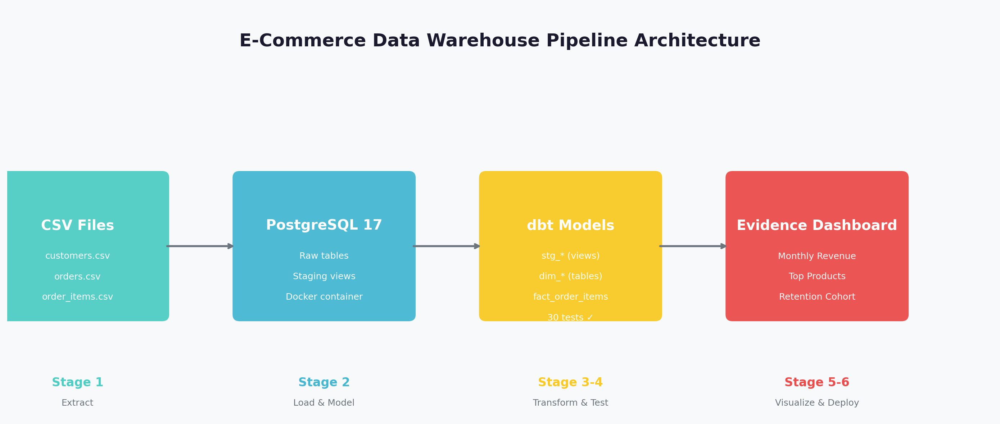

[](https://review-pipeline-47wlmbfayhc759wwvepuz9.streamlit.app/)
[](https://zik0-amz06.github.io/review-pipeline/)

# E-Commerce Data Warehouse Pipeline

End-to-end data pipeline: **CSV -> PostgreSQL -> dbt -> Streamlit Dashboard**



## Quick Start

```bash
# 1. Start database
docker compose up -d postgres

# 2. Load raw data (one-time)
psql -h 127.0.0.1 -p 5433 -U review_app -d reviews -f sql/01_create_raw_tables.sql
psql -h 127.0.0.1 -p 5433 -U review_app -d reviews -f sql/02_load_csvs.sql

# 3. Run Python ingestion (idempotent, fetches FX rates)
pip install -r ingest/requirements.txt
python ingest/load_data.py

# 4. Build dbt models + run tests
pip install dbt-postgres
dbt run
dbt test

# 5. View docs
dbt docs generate && dbt docs serve --port 8080

# 6. Launch dashboard
streamlit run dashboard_app.py
```

## Architecture

```mermaid
graph LR
    A[CSV Files] --> B[PostgreSQL (Raw/Stg)]
    B --> C[dbt (Dims/Fact)]
    C --> D[Streamlit Dashboard]
```

## What It Answers

| Question | Source |
|----------|--------|
| Monthly revenue? | `fact_order_items` grouped by `year_month` |
| Top 5 products? | `fact_order_items` grouped by `product_name` |
| Returning customers? | `customer_id` with `COUNT(DISTINCT order_id) > 1` |
| Missing/incorrect payments? | Currency breakdown + FX normalization |

## Data Quality

All issues documented in [dashboard/pages/data_quality.md](dashboard/pages/data_quality.md):

- **Currency mixing** -> FX normalization in Python loader
- **Text columns** -> Staging models cast to proper types
- **No FKs** -> dbt relationship tests
- **Price drift** -> dim_product takes latest price

## Testing

```bash
dbt test  # 30 tests: unique, not_null, relationships
```

## Project Structure

```
├── data/                    # Source CSVs
├── sql/                     # Raw table creation + loading
├── ingest/                  # Python loader (FX + upsert)
├── models/                  # dbt models
│   ├── staging/            # stg_* (views)
│   └── marts/              # dim_*, fact_* (tables)
├── dashboard_app.py         # Streamlit dashboard
├── docs/                    # Architecture diagram
└── .github/workflows/ci.yml # CI/CD
```

## Tech Stack

| Layer | Tool |
|-------|------|
| Database | PostgreSQL 17 (Docker) |
| Transform | dbt (SQL) |
| Ingestion | Python (pandas, psycopg2, requests) |
| Dashboard | Streamlit (Python) |
| Tests | dbt (unique, not_null, relationships) |
| FX Rates | Frankfurter API (free, no key) |

## Learning Path (10-12 weeks)

| Stage | Weeks | Focus | Status |
|-------|-------|-------|--------|
| 1. SQL Foundations | 2 | Joins, CTEs, window functions | [x] |
| 2. Data Modeling | 2 | Facts, dims, grain, reconciliation | [x] |
| 3. Python Ingestion | 2 | Files, HTTP, JSON, logging | [x] |
| 4. Reliable Updates | 1-2 | Incremental, idempotent, quarantine | [x] |
| 5. Testing & Automation | 2 | dbt tests, scheduling | [x] |
| 6. Portfolio Delivery | 1-2 | Docs, dashboard, CI/CD | [x] |

## Next Steps

- [x] Add incremental staging models
- [x] Quarantine table for bad rows
- [x] GitHub Actions CI/CD (`dbt build`)
- [ ] Schedule with cron/Airflow
- [ ] Deploy dashboard (Netlify/Vercel)
